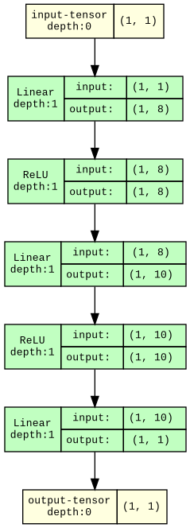
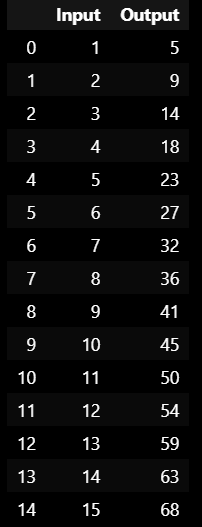
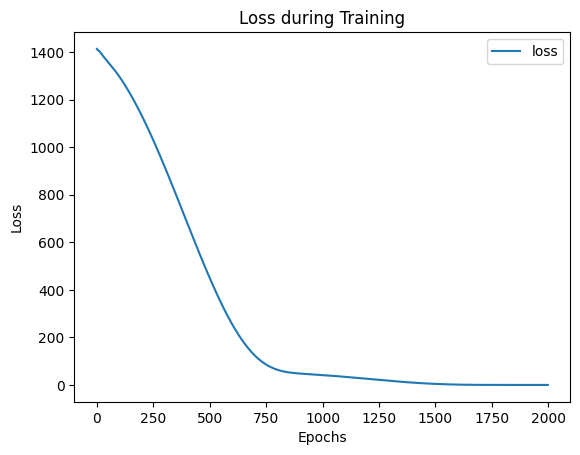

# Developing a Neural Network Regression Model

## AIM
To develop a neural network regression model for the given dataset.

## THEORY
A Study on the Relationship Between Student Scores and Hours Learned

## Neural Network Model


## DESIGN STEPS
### STEP 1: 

Create your dataset in a Google sheet with one numeric input and one numeric output.

### STEP 2: 

Split the dataset into training and testing

### STEP 3: 

Create MinMaxScalar objects ,fit the model and transform the data.

### STEP 4: 

Build the Neural Network Model and compile the model.

### STEP 5: 

Train the model with the training data.

### STEP 6: 

Plot the performance plot

### STEP 7: 

Evaluate the model with the testing data.

### STEP 8: 

Use the trained model to predict  for a new input value .

## PROGRAM

### Name: Bharath Raj P

### Register Number: 212223230031

```python

import torch
import torch.nn as nn
import torch.optim as optim
import pandas as pd
from sklearn.model_selection import train_test_split
from sklearn.preprocessing import MinMaxScaler

dataset1 = pd.read_csv('data.csv')
X=dataset1[["Input"]].values
y=dataset1[["Output"]].values

X_train, X_test, y_train, y_test = train_test_split(X, y, test_size=0.33, random_state=33)

scaler = MinMaxScaler()
X_train = scaler.fit_transform(X_train)
X_test = scaler.transform(X_test)

X_train_tensor = torch.tensor(X_train, dtype=torch.float32)
y_train_tensor = torch.tensor(y_train, dtype=torch.float32).view(-1, 1)
X_test_tensor = torch.tensor(X_test, dtype=torch.float32)
y_test_tensor = torch.tensor(y_test, dtype=torch.float32).view(-1, 1)

# Name: Bharath Raj P
# Register Number: 212223230031
class NeuralNet(nn.Module):
  def __init__(self):
        super().__init__()
        self.fc1=nn.Linear(1,8)
        self.fc2=nn.Linear(8,10)
        self.fc3=nn.Linear(10,1)
        self.relu=nn.ReLU()
        self.history={'loss': []}
  def forward(self,x):
        x=self.relu(self.fc1(x))
        x=self.relu(self.fc2(x))
        x=self.fc3(x)
        return x

# Initialize the Model, Loss Function, and Optimizer
lig=NeuralNet()
criterion=nn.MSELoss()
optimizer=optim.RMSprop(lig.parameters(),lr=0.001)

# Name: Bharath Raj P
# Register Number: 212223230031
def train_model(ai_brain, X_train, y_train, criterion, optimizer, epochs=2000):
    #Include your code here
     for epoch in range (epochs):
        optimizer. zero_grad()
        loss=criterion(ai_brain(X_train), y_train)
        loss. backward()
        optimizer.step()
        lig .history['loss'].append(loss.item())
        if epoch % 200 == 0:
            print(f'Epoch [{epoch}/{epochs}], Loss: {loss.item():.6f}')

train_model(lig, X_train_tensor, y_train_tensor, criterion, optimizer)

with torch.no_grad():
    test_loss = criterion(lig(X_test_tensor), y_test_tensor)
    print(f'Test Loss: {test_loss.item():.6f}')

loss_df = pd.DataFrame(lig.history)

import matplotlib.pyplot as plt
loss_df.plot()
plt.xlabel("Epochs")
plt.ylabel("Loss")
plt.title("Loss during Training")
plt.show()

X_n1_1 = [16]
scaled_input = scaler.transform([X_n1_1])
prediction = lig(torch.tensor(scaled_input, dtype=torch.float32)).item()
print(f'Prediction: {prediction}')
```

### Dataset Information


### OUTPUT

### Training Loss Vs Iteration Plot


### New Sample Data Prediction


## RESULT
Thus, a neural network regression model was successfully developed and trained using PyTorch.
